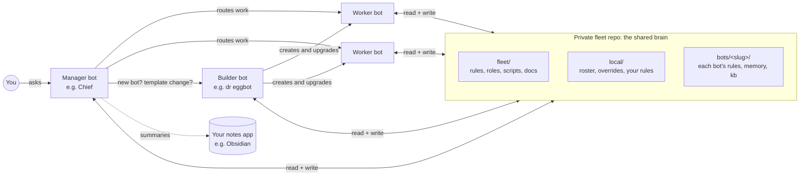

# bot-fleet-template

**Give your AI assistant bots a shared git brain, so they remember, stay in sync and work as a team.**

AI assistant bots forget. Chats get compacted, platform memory is a black box, and instructions drift every time someone edits a prompt. Run more than one bot and it gets worse: nobody knows which bot owns which job, and nothing stops one bot from overwriting another's notes.

This template turns a private git repo into the durable home of your whole fleet. Every bot re-reads its rules and state from files on every run, writes back what it learns, and can be restored from scratch with one sentence. Permissions follow the folder structure, and template upgrades reach every bot the same way.

> Built for Grok Bot fleets, but the pattern works for any assistant that can run a shell and git.

## Why this exists

These all happened in the fleet this template came from:

- **The calendar fix it forgot.** The assistant walked its owner through setting up calendar access, then later went back to the old calendar because an older note still said the main one was unreachable. *Fix:* one current fact per file, dated, so the newer fact replaces the old one instead of competing with it.
- **The saved login it didn't know about.** The owner had already stored a card and a travel-site login in the assistant's vault, but it didn't use them until told explicitly. *Fix:* the bot's files record which services and credentials are set up (never the secrets), and bots check them before asking.
- **The trip that went to the same place twice.** The assistant lost track of what had already been planned, and the next draft itinerary sent its owner back to a stop they'd already covered. *Fix:* plans and decisions live in files the bot re-reads on every run.
- **The correction that lived only in chat.** The owner corrected a delivery estimate ("it arrived next day, not in three"), but only in conversation, so nothing durable stopped the old figure from coming back. *Fix:* corrections are written to the bot's rules in git.
- **The false alarm.** A monitor reported a bot's daily digest as missed when it had in fact posted. *Fix:* verify against the source before alerting, and write the lesson into rules.
- **The rename that broke identity silently.** A bot's folder was renamed, but its checkout kept the old git identity, so its next save was rejected. *Fix:* identity is checked on every commit, and `validate.sh` checks each worktree's identity against its folder.

Legend: ✅ built and tested in this release · 🧪 proposed, not built yet.

## What you get

- ✅ **A durable copy of every bot**: instructions, rules, routines, memory and state in plain files you own.
- ✅ **Let your bot set it up**: a two-phase, chat-driven bootstrap. One bot becomes the manager, creates a builder bot, and the builder sets up the repo ([install-manager.md](fleet/docs/install-manager.md)).
- ✅ **Layered rules**: common rules → fleet overrides → your local rules → role → bot. Written as principles, not checklists.
- ✅ **Roles**: `manager` (coordinates), `builder` (creates and maintains bots), `worker`, `retired`, with checks that a live fleet has one active manager and an active builder.
- ✅ **Enforced ownership**: `OWNERS.json` + a pre-commit hook. A bot can only write its own folder.
- ✅ **One worktree per bot** on a shared machine, with a per-worktree git identity.
- ✅ **Thin prompt template**: `{{BOT_NAME}}`/`{{OWNER_NAME}}` placeholders rendered per bot from `local/fleet.json`.
- ✅ **Safety net**: snapshots outside git before every change, a restore runbook, a confidentiality scanner on every commit.
- ✅ **Versioned upgrades** with idempotent migrations (`upgrade.sh`), plus CI validation and an end-to-end self-test.
- ✅ **Ready-made example bots** (`examples/`: a notes keeper and a package tracker) and a **weekly audit**.
- 🧪 **Shared skills, two-level logs and a daily fast-forward routine** (see [Roadmap](#roadmap)).

## The picture

Names are yours to choose. "Chief" and "dr eggbot" are just suggestions; scripts refer to roles.

## Quick start

### Option A: let your bot do it (✅ two-phase bootstrap)
You start with one bot and talk to it. You only sign in to GitHub yourself (`gh auth login` on the bots' machine); bots never handle your passwords or tokens.

**Phase 1: pre-fleet.** Ask your bot: *"Follow fleet/docs/install-manager.md from https://github.com/yuntaoL/bot-fleet-template."*
- It asks for names (Chief suggested) and your display name, checks prerequisites and, with your yes, creates a builder bot (dr eggbot suggested).
- The builder follows [bootstrap-fleet.md](fleet/docs/bootstrap-fleet.md): private repo from this template, worktrees, per-bot git identity, rendered prompts, log and snapshot folders, then runs `selftest.sh` and `validate.sh --pre-fleet`.
- No bot's prompt changes yet. Both still run on platform memory.

**Phase 2: conversion.** One bot at a time, with your yes at each step ([convert-to-fleet-bot.md](fleet/docs/convert-to-fleet-bot.md)):
- The manager converts itself: snapshot → copy memory into git → git-first prompt with the old prompt as fallback → 5 verified runs → drop the fallback. The builder holds the rollback.
- The builder then converts itself the same way, with the manager holding the rollback.
- From then on the builder creates new bots on demand.

The git side of both phases is tested end to end by `fleet/scripts/selftest.sh` (scratch repos, fake owner and bots, a forced rollback). Steps on the bot platform itself (creating a bot, editing its prompt) are done by your bots with your yes.

### Option B: by hand
1. **Use this template** → create a **private** repo, clone it on the machine your bots share, set your git identity.
2. `fleet/scripts/bootstrap.sh https://github.com/yuntaoL/bot-fleet-template.git && git push`
3. Set `owner_name` and add bots to `local/fleet.json`, seed `bots/<slug>/` (or `add-example.sh`), run `fleet/scripts/worktree.sh --all`.
4. `fleet/scripts/render-prompt.sh <slug>` and put `bots/<slug>/THIN-PROMPT.md` at the top of each bot's instructions.
5. `fleet/scripts/validate.sh` → green. Full guide: [ADOPTION.md](fleet/docs/ADOPTION.md).

## How it works

| Piece | What it does | Status |
|---|---|---|
| Thin prompt | `templates/THIN-PROMPT.tmpl`, rendered per bot by `render-prompt.sh`: go to your worktree, read your rule layers and state, follow them, write back | ✅ |
| Rule layers | `fleet/rules/common.md` → `local/overrides.md` → `local/rules/` → role → `bots/<slug>/rules.md` | ✅ |
| Roles | Manager, builder, worker, retired defaults in `fleet/roles/` | ✅ |
| Ownership | `fleet/OWNERS.json`, enforced by `check-boundary.sh` (pre-commit) and `validate.sh` (CI) | ✅ |
| Saving | `fleet/scripts/sync.sh "msg" [paths]`: commit as yourself, rebase, push | ✅ |
| Bootstrap state | `state.json` `bootstrap {phase, step, status, snapshot, rollbackHolder}`; reruns resume; `validate.sh --pre-fleet` for phase 1 | ✅ |
| Upgrades | `upgrade.sh <version>` pulls a tagged template release and runs migrations | ✅ |
| Audit | `fleet/docs/AUDIT.md` + `audit.sh`, weekly | ✅ |
| Restore | `RESTORE.md` rebuilds the fleet from the repo; `RESTORE-BOT.md` + `snapshot-fleet.sh` roll one bot back | ✅ |
| Knowledge base layout | `bots/<slug>/kb/` with `INDEX.md` files (opt-in layout + warn-only checks, [KB-LAYOUT.md](fleet/docs/KB-LAYOUT.md)) | ✅ |
| Template vs instance | Every change is classified first: generic changes go upstream, yours stay in `local/` and `bots/` ([CONTRIBUTING](fleet/docs/CONTRIBUTING.md)) | ✅ |
| Shared skills | Hand-off, kb read/write, journal, notes publishing | 🧪 |
| Two-level logs | One lean line per run in git; details on local disk, auto-cleaned | 🧪 |
| Daily fast-forward | Builder routine that fast-forwards every worktree and reports anything dirty | 🧪 |

## Safety

- ✅ **Nothing personal in the template.** Your rules, roster and data live only in your private fleet repo.
- ✅ **Bots can't write each other's files**: ownership is checked on every commit.
- ✅ **Approvals are rules, not hopes**: common rules require your yes before sending, buying or changing other bots.
- ✅ **Snapshots before every change** to a bot (`snapshot-fleet.sh`, outside git, checksummed), with a restore runbook.
- ✅ **Confidentiality scanner**: a pre-commit check, with patterns kept outside git, that blocks sensitive topics from reaching git.
- ✅ **Expand, then contract; canary first; one bot at a time**: the deployment rules in CONTRIBUTING and the conversion guide.

## Customize it

- **Any names.** Pick a slug and display name per bot in `local/fleet.json`; the role does the work.
- **Your rules** go in `local/rules/` and `local/overrides.md`. They survive every upgrade.
- **Template vs instance.** Ask "would a stranger using this template want it?" If yes, open a PR or issue on this template repo ([CONTRIBUTING](fleet/docs/CONTRIBUTING.md)). If not, it belongs in your fleet repo.

## FAQ

**Does my fleet repo have to be private?** Yes. It holds your rules and your bots' memory. Only this template is public.

**What if my assistant platform loses a bot?** Create a fresh bot and tell it: *"Clone <repo> and follow fleet/docs/RESTORE.md."*

**Do I need to know git?** Not with Option A: your bots run the commands. You sign in to GitHub once.

**Can two bots edit the same file?** No. Each file has one owner. Bots hand requests to the owner instead.

**How do upgrades reach my bots?** The manager runs `upgrade.sh`, then each bot's worktree is fast-forwarded (by hand or by the builder today; a 🧪 daily routine later).

**Which assistants does it work with?** Designed for Grok Bot. Anything with shell and git access should work.

## Roadmap

| Item | Status |
|---|---|
| Layout, ownership, hook, CI, rule layers, roles | ✅ v0.6 |
| Bootstrap script, worktrees, sync, upgrade + migrations, restore, audit, examples | ✅ v0.6 |
| Template-vs-instance policy, snapshots, restore runbook, confidentiality scanner, kb layout, bot registry cards | ✅ v0.7 |
| Two-phase bootstrap guides, `--pre-fleet`, required-role checks, thin prompt template, self-test | ✅ v0.8 |
| Required-role checks fail by default (warn in v0.8) | 🧪 next |
| Shared skills, two-level logs, daily fast-forward | 🧪 proposed |

## Contributing

Guidance changes go upstream first: open a PR against this repo. Each change bumps `fleet/VERSION`, adds a [CHANGELOG](fleet/docs/CHANGELOG.md) entry with migration notes and, if user data moves, an idempotent `fleet/migrations/X.Y.Z.sh`. Run `fleet/scripts/selftest.sh` before opening a PR. See [CONTRIBUTING](fleet/docs/CONTRIBUTING.md) and [VERSIONING](fleet/docs/VERSIONING.md). Keep it generic: no personal data in PRs.

## License

MIT. See [LICENSE](LICENSE).
